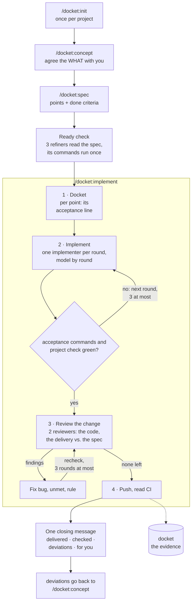

<p>
  <picture>
    <source media="(prefers-color-scheme: dark)" srcset="assets/logo-dark.svg">
    
  </picture>
</p>


Spec in, docket out. A Claude Code plugin that separates thinking from building and makes the building verifiable.

A **delivery docket** is the slip that travels with a shipment and proves what was delivered. Here, every spec
gets one docket: a list of what counts as done, registered before the first code, filled with evidence, written by
the team and read by you.

## What it is for

Long, autonomous implementation runs. You think with the model until the WHAT is agreed, write it down as a
spec, then hand it over: one session runs for hours, spawns its own agents, verifies its own work and ends with
one message. docket exists so that such a run can be trusted without watching it: the run checks its own work
against commands written down before the first code, the docket shows what was done with evidence you can check,
and hooks hold only the rules that have no exception (your project rules and the gate before delivered).

It is not a chat assistant for quick edits. The modes before the run are short; the run itself is long.

## Install

Requires Python 3 on PATH. Hooks use the standard library only.

```bash
claude plugin marketplace add hwein/docket
claude plugin install docket@docket
```

Then, in a project: `/docket:init`.

Update (restart Claude Code afterwards):

```bash
claude plugin marketplace update docket
claude plugin update docket@docket
```

Claude Code keeps its own copy of each installed version, so a session never runs a half-updated plugin. Every
push to this repository runs the hook tests on Linux and Windows (`.github/workflows/test.yml`); the badge on the
latest commit shows whether they passed.

The plugin ships an output style, `docket:docket`: the result first, at most one question with a recommendation,
titles instead of ids, one message when the agents are back. It is your choice (`/config`); docket does not set it.

## The ideal workflow

1. **Once per project:** `/docket:init`. The repo is audited, you answer only what it cannot answer,
   `DOCKET.md` holds the result.
2. **Think:** `/docket:concept`. One idea at a time, one question at most. Finished dockets are weighed here;
   what differs from a spec is decided here, not patched later.
3. **Decide:** `/docket:spec`. The agreed WHAT becomes a spec: points with done criteria a command checks, your
   decisions closed with one word each, reference docs named. Before it is `ready`, three refiner agents read it
   (against the code, against its concept and the reference docs, from your project's angle) and every
   precondition and acceptance command runs once, so a run does not start on a spec it cannot carry out.
4. **Leave:** `/docket:implement <id>`. A docket with one acceptance line per point before the first code, one
   implementer per round, checks run by the orchestrator itself, a review of the whole change from two angles,
   commits per the project's rules. A message you write during the run is answered at once; `/docket:stop` ends
   the run cleanly. Nothing asks you anything until the run is over: what only you can decide or provide is noted
   and reaches you in the closing message, and the run goes on with everything that does not depend on it.
5. **Read:** one message for the whole run, in your language: per spec whether it is delivered, what works now,
   the commands it checked with their results, what deviated, and what is for you to do. The dockets hold the
   evidence. What deviated goes back to step 2.

Several specs can wait as `ready`; several sessions can run on different specs at once, each locked to its own.
For a series, `/effort high` in the session keeps the effort the run's text asks for across all its turns.



## Commands

Typed with the plugin's namespace, as Claude Code lists them: `/docket:concept`, `/docket:init`.

| Command | What happens |
|---|---|
| `/docket:init` | Audits the repo, asks you only where it is silent, writes `DOCKET.md` after your `go`. |
| `/docket:concept` | Thinks with you. One idea per message, one question at most. |
| `/docket:spec` | Turns the agreed WHAT into a spec with checkable done criteria, checks it, then `ready`. |
| `/docket:implement [...]` | Runs one spec or a series of specs autonomously and ends with one message (forms below). |
| `/docket:register` | The register: concepts, specs, dockets, last LOG lines. |
| `/docket:status` | One line: mode, spec, open points, last LOG line. |
| `/docket:stop` | Ends a run at the next checkpoint. |

`/docket:implement` is a skill: the model can call it as well, and the run starts the same way.

## One spec or a series

A concept ends in one spec or several, in an order (`follows:` in the spec's header for a spec that reworks an
earlier one, `after: <id>` in its goal for a spec that needs another one landed first). `/docket:implement` runs
them the same way, one after another in one session, each with its own docket and merge; the run ends with one
message for all of them:

| Call | Runs |
|---|---|
| `/docket:implement` | the next ready spec whose predecessors are done |
| `/docket:implement s-1a2b3c4d` | this spec |
| `/docket:implement s-1a2b3c4d, s-5e6f7a8b` | exactly these, in this order |
| `/docket:implement c-9c8d7e6f` | every ready spec of this concept, in implementation order |
| `/docket:implement --all` | every ready spec of the project, in implementation order |

Implementation order: a spec after every predecessor (`follows:` and `after:`), otherwise by creation date. A call
that would run a spec before an undone predecessor starts no run and names the predecessor. When a spec has ended,
docket starts the next one in the same session. A spec that ends blocked takes only its successors with it: the
specs that do not wait for it still run. It ends the series only when it left work in the project that is not
pushed, since the next spec's push would carry it. The closing message names the specs not started by their
titles, says why each did not start and gives the command that takes them up, `/docket:implement <ids>`: those
specs and each blocked spec one of them waits for, in series order. `/docket:stop` ends the series at the next
checkpoint; the stopped spec is then among those ids.

## How a run works

1. Preconditions first: each line of the spec's `Preconditions (user only)` runs in the shell it is written for.
   One that is not met holds up only its own spec.
2. A docket is written before the first code: one line per point with its acceptance line, the command that will
   count and what it must show.
3. One implementer agent per spec and round, at most three rounds, each on the model `model_ladder` in `DOCKET.md`
   names for it (by default sonnet, opus, fable). The orchestrator reads every diff and runs every acceptance
   command and the project check itself. A failed round hands the next one the failed command and its output; a
   diagnoser agent may examine a failure first.
4. Every delivered point gets its evidence line; what differs from the spec, or what only you can decide or
   provide, becomes a deviation line, and the run goes on with all that does not depend on it.
5. Two reviewer agents read the whole change before it is pushed: one the code, one the delivery against the
   spec, neither the orchestrator's docket. A bug, an unmet point or a broken rule is fixed or refuted with a
   source; every other finding reaches you in the closing message. What a fix wrote is read again, three rounds at
   most.
6. Merge and push as the project says; with `ci` set, the CI state of the pushed commit. The spec ends in its
   docket: delivered or blocked, with what works now, what only you can do and the proposals for later.
7. The run ends with one message, written by the orchestrator from the dockets after a template, in the language
   `DOCKET.md` sets.

## What you can rely on

- A delivered spec means: no point is open, the project's own check and every delivered point's acceptance command
  ran after the last agent and did not fail. docket reads that from the session's transcript and answers a
  `DELIVERED` with a gap once, with the facts.
- docket enforces five things and nothing else: no write into `forbidden_paths`, no push to a branch outside
  `push_branch`, no commit against `commit_regex`, no command from `forbidden_commands` in a run, and the gate before
  delivered. Outside a run, a command from `forbidden_commands` runs after your click in Claude Code's permission
  dialog. When you explicitly ask in the chat for something one of these four keys rules out, the session changes
  that key in `DOCKET.md` itself and says so in one line; without such a word, `DOCKET.md` holds.
- Every command under `Checked:` in the closing message is one the orchestrator ran itself, with the result it saw;
  what it did not check is named.
- You get back what the run could not do: a decision only you can take, a command docket did not run, a review
  finding it did not fix, a proposal for later. What the run could do itself, it did.
- The log is written by docket's hooks, not by the model.

## What you see

- During a run: the pane shows the spec at work and its points. At the end: one message for the whole run, in
  your language.
- How the hooks work: [HOOKS.md](HOOKS.md).

## The pane

In a project with a `DOCKET.md` a pane opens beside the chat; `/docket-pane` brings it back.

- Register: every concept with its specs, specs without a concept in a group of their own. Each spec shows its
  state (draft, ready, in progress, done, superseded) and what holds it: the spec it waits for, open decisions,
  a blocked last run. A counter per state stands on top and, as one line, under the prompt.
- A spec opens to its text, its docket and its LOG lines; a done spec's docket is one click from the register.
- Buttons: implement a spec, every ready spec of a concept, or the ready specs you tick, in this session or in a
  session of its own (Claude Code Desktop); mark a spec as superseded, with the spec that replaces it; stop a
  run; refresh. Several specs run as one series, in implementation order, one after another.
- A running spec shows with its points and its place in the series; when it ends you are told once.
- Tabs for the LOG and for `DOCKET.md`.
- In a project docket is not set up in, a line above the prompt offers `/docket:init`; `Hide` removes it for that
  project for good.

The pane changes nothing by itself: a button runs the command you would type, and `superseded` is written with its
LOG line (`superseded … by=s-…`) by the plugin's own code, as every other state is. It is drawn through Claude
Code's function hooks, an early-access API: where a client does not draw panes, the commands work as before.

## Where things live

- Plugin: this repository, installed as Claude Code's own copy. It adds no code to your repository.
- Project: `.claude/docket/` for session state (gitignored).
- Work dir with `DOCKET.md`, `specs/`, `dockets/`, `LOG.md`: `~/.docket/<repo key>/` by default, with its own
  git history. `/docket:init` offers `docket/` inside the repo instead.

## Layout

```
commands/       concept, spec, init, register, status, stop
skills/         implement (the run's text)
agents/         refiner, implementer, diagnoser, reviewer, fixer
output-styles/  docket (the form of the messages, your choice)
hooks/          hooks.json, Python hooks, tests
hooks/mod/      the pane (function hooks, TypeScript), its tests
templates/      DOCKET.md, concept.md, spec.md, delivery-docket.md, closing-message.md
evals/          the comparison test: cases, fixtures, headless runs, report
HOOKS.md        what each hook refuses, asks and records
```

Tests: `python hooks/test_hooks.py`; the pane: `claude plugin test .`. `evals/` is this project's comparison test
(the same cases as headless `claude -p` runs without the plugin, with 0.5.11 and with this tree), not
`claude plugin eval`.

## Upgrading from 0.5

1. The first session start in each project removes docket's judge entry from `.claude/settings.json` and
   `.claude/settings.local.json`, a changed copy of it too. A settings file git tracks shows a change afterwards.
   The removed entry is kept in `.claude/docket/judge-removed.json`.
2. A command from `forbidden_commands` no longer ends a spec `BLOCKED` in a run: docket does not run it, the run
   notes it as a deviation, goes on and names it in the closing message. Outside a run docket asks you in the
   permission dialog, as before.
3. Preconditions are run by the run itself, as the first step of their spec; one that is not met holds up only its
   spec.
4. `DELIVERED` needs only the project check, the acceptance commands and no open point. Reference docs, CI line,
   refinement and review lines are steps of the run and lines of the docket, no longer conditions of a hook.
5. `model_ladder` has a default per round (sonnet, opus, fable; fixer haiku); the values of an existing
   `DOCKET.md` still hold. `third_refiner_angle` now acts in `/docket:spec`.
6. Gone: the stamp line, required reading, rewrite, DISSENT, triage, `/docket:spec <number>` and the agent
   `conceptor`. Existing dockets stay readable (a DISSENT closes like BLOCKED), and `ready` specs run as they are.
7. Left lying and no longer read: `inbox/`, `metrics/*.violations.json`, `.claude/docket/proposals.json`. Lines of
   an existing `DOCKET.md` that name the judge, required reading or the stamp have no effect.
8. End running runs before the update. A series of 0.5 goes on with `/docket:implement <id>`, from its docket and
   the LOG.
9. The output style `docket:docket` is new; choose it in `/config` if you want its form of the messages.
10. When you explicitly ask in the chat for something `forbidden_paths`, `push_branch`, `commit_regex` or
    `forbidden_commands` rules out, the session changes that key in `DOCKET.md` itself and says so in one line.

## Status

0.6.1, an early stage of development, already in use in several repositories.

docket tries not to weigh on existing projects: by default the work dir lives outside the repo, and
`/docket:init` shows every change it would make to the repo as a diff and writes only after your go. Much of
it is yours to set: branch, commit form, forbidden paths and commands, the models per round, whether the work dir
sits in the repo.

No warranty. AI makes mistakes, a run that checks itself included. Use docket only where you can verify that
the result is correct.

docket is deliberately not built to save tokens, nor to spend them. It is built for autonomy and for less
cognitive load on your side.
