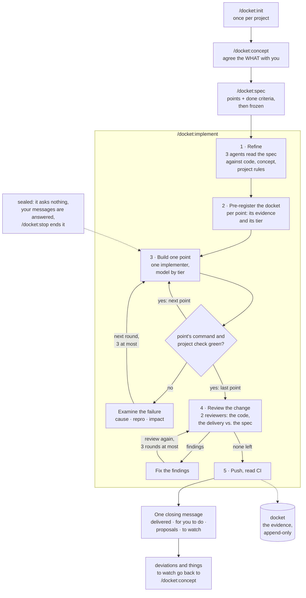

<p>
  <picture>
    <source media="(prefers-color-scheme: dark)" srcset="assets/logo-dark.svg">
    
  </picture>
</p>


Spec in, docket out. A Claude Code plugin that separates thinking from building and makes the building verifiable.

A **delivery docket** is the slip that travels with a shipment and proves what was delivered. Here, every spec
gets one docket: a pre-registered list of what counts as done, filled with evidence, append-only, written by the
team and read by you.

## What it is for

Long, autonomous implementation runs. You think with the model until the WHAT is agreed, write it down as a
spec, then hand it over: one sealed session runs for hours, spawns its own agents, verifies its own work and
ends with one message. docket exists so that such a run can be trusted without watching it: the rules are
enforced by hooks, not by prompts, and the docket shows what was done, with evidence you can check.

It is not a chat assistant for quick edits. The modes before the run are short; the run itself is long.

## Install

Requires Python 3 on PATH. Hooks use the standard library only.

```bash
claude plugin marketplace add hwein/docket
claude plugin install docket@docket
```

Then, in a project: `/docket:init`.

Update (restart Claude Code afterwards):

```bash
claude plugin marketplace update docket
claude plugin update docket@docket
```

Claude Code keeps its own copy of each installed version, so a session never runs a half-updated plugin. Every
push to this repository runs the hook tests on Linux and Windows (`.github/workflows/test.yml`); the badge on the
latest commit shows whether they passed.

## The ideal workflow

1. **Once per project:** `/docket:init`. The repo is audited, you answer only what it cannot answer,
   `DOCKET.md` holds the result. From here every session carries the project's rules.
2. **Think:** `/docket:concept`. One idea at a time, one question at most. Finished dockets are weighed here;
   what differs from a spec is decided here, not patched later.
3. **Decide:** `/docket:spec`. The agreed WHAT becomes a spec: points with done criteria a script can check,
   your decisions closed with one word each, reference docs named. Then it is `ready` and frozen.
4. **Leave:** `/docket:implement <id>`. What only you can provide, a key or a running server, is checked first;
   then the session seals. Refinement, pre-registered docket, one implementer per point, checks run by the
   orchestrator, a review of the whole change from two angles, commits per the project's rules. A message you write
   during the run is answered at once; `/docket:stop` ends the run cleanly. Nothing asks you anything until the run
   is over, and nothing you type is ever refused: where a command cannot start, you are told why and what to do.
5. **Read:** one short message for the whole run, in your language: whether the work is pushed and CI is green,
   one line per spec with what it delivered, then only what you act on: what only you can do, and the proposals
   for later, numbered. You get back only what the run could not do itself; what it could repair it repaired,
   and the message says so. The dockets hold the evidence and the notes. What deviated goes back to step 2.

Several specs can wait as `ready`; several sessions can run on different specs at once, each locked to its own.



## Commands

Typed with the plugin's namespace, as Claude Code lists them: `/docket:concept`, `/docket:init`.

| Command | Mode | What happens |
|---|---|---|
| `/docket:init` | init | Audits the repo, asks you only where it is silent, writes `DOCKET.md` after your `go`. |
| `/docket:concept` | concept | Thinks with you. One idea per message, one question at most. |
| `/docket:spec` | spec | Turns the agreed WHAT into a spec with checkable done criteria, then `ready`. |
| `/docket:implement [...]` | sealed | Runs one spec or a series of specs autonomously and ends with one final message (forms below). |
| `/docket:register` | | The register: concepts, specs, dockets, last LOG lines. |
| `/docket:status` | | One line: mode, spec, open points, last LOG line. |
| `/docket:stop` | | Ends a sealed run at the next checkpoint. |

## One spec or a series

A concept ends in one spec or several, in an order (`follows:` in the spec's header for a spec that reworks an
earlier one, `after: <id>` in its goal for a spec that needs another one landed first). `/docket:implement` runs
them the same way, one after another in one session, each with its own refinement, docket and merge; the run ends
with one message for all of them:

| Call | Runs |
|---|---|
| `/docket:implement` | the next ready spec whose predecessors are done |
| `/docket:implement s-1a2b3c4d` | this spec |
| `/docket:implement s-1a2b3c4d, s-5e6f7a8b` | exactly these, in this order |
| `/docket:implement c-9c8d7e6f` | every ready spec of this concept, in implementation order |
| `/docket:implement --all` | every ready spec of the project, in implementation order |

Implementation order: a spec after every predecessor (`follows:` and `after:`), otherwise by creation date. A call
that would run a spec before an undone predecessor is refused and names the predecessor. When a spec has ended,
the hook seals the next one in the same session. A spec that ends blocked or in dissent takes only its successors
with it: the specs that do not wait for it still run. It ends the series only when it left work in the project
that is not pushed, since the next spec's push would carry it. The closing message names the specs not started by
their titles, says why each did not start and gives the command that takes them up. `/docket:stop` ends the series
at the next checkpoint.

## How a sealed run works

1. Three refiner agents read the spec against the code, the concept and the project rules.
2. A docket skeleton is pre-registered: one line per point with the evidence that will count, and the point's
   tier (simple, standard, complex), which picks the implementer's model.
3. One implementer agent per point, at most three rounds, each rework round on a stronger model and briefed with
   what failed. The orchestrator reads every diff and runs the point's own command and the project check itself.
   A failure gets its second attempt only after a diagnoser agent examined it: where it comes from, whether a
   command shows it (three runs at most, no time limit), who notices what. A third attempt needs a named cause.
   An error the code does not explain may be looked up on the web, three lookups at most: to read the error,
   never to reopen what the spec decided.
4. Every delivered point gets its evidence line; what differs from the spec becomes a deviation line.
5. Two reviewer agents read the whole change before it is pushed: one the code, one the delivery against the
   spec, neither the orchestrator's docket. Every finding is decided in the docket; a bug, an unmet point or a
   broken rule is fixed or refuted, never deferred. What a fix wrote is reviewed again, three rounds at most.
   What a reviewer suspects but cannot show is examined the same way before anyone fixes it.
   Then the run settles what is left: a finding not yet fixed, a fault it measured beside the order, a line the
   delivery made wrong. What it can repair without a decision of yours it repairs, as a commit of its own.
6. The spec ends in its docket: delivered, blocked or in dissent, with its result in one sentence, what was
   repaired outside the order, and the proposals for later, each with what kept the run from doing it itself.
   A CI run that turns red is made green in the same run, also when its cause lies outside the order;
   where that is not possible, the closing message says what the fault is, why it was not repaired and what you
   can do.
7. The run ends with one message, which the hook writes from the dockets and git, in the language `DOCKET.md`
   sets.

While it runs you see a status line, and only when something changed: which spec of how many, its title, the
points delivered. Your own messages reach the orchestrator, which answers them on the screen and goes on; they
are kept in an inbox too, and the closing message says what came of them.

## What you can rely on

- A spec that is `ready` does not change under you; a rewrite is a logged event.
- A delivered spec means: the project's own check ran green after the last agent, every delivered point's own
  command ran green after the last change, every reference doc the spec names is updated or accounted for.
- docket never stands in its own way. A run ends short of delivered only for what your project lacks or what only
  you can do, never over a line of docket's own records, and you are never left with a problem of the record
  instead of the state of your project.
- You get back only what the run could not do. A proposal in the closing message is work after the run, and its
  docket line says what kept the run from doing it (it changes what the spec orders, it needs your decision, it
  lies in a forbidden path, three rounds were spent); a review finding the run did not fix reaches you by name.
  Nothing is counted that you would have to ask for.
- The closing message is in blocks: what is implemented and pushed and the CI state; each spec by its title;
  "For you to do", as numbered steps or "nothing"; what the run repaired outside the order; the proposals for
  later, numbered, each by what to do and why (`/docket:spec 2` makes a spec of the second); each thing to
  watch by what it is about. No line is cut, no sentence stands twice, and an id stands only inside a command
  whose line names the titles.
- Nothing is pushed before the review of the whole change is decided, finding by finding, and before reviewer
  agents have read the last change: a review written into the docket without them is refused.
- A run does not chase a symptom and does not wave a fault away. "Possible fault, needs watching" is the late
  exit: it stands only after three runs of the command that should show it and after a second agent tried to
  refute the first one's answer. It reaches you under "To watch" in the closing message by what it is about; the
  docket holds the whole case (what was seen, what is suspected, the impact, what to look for), ready to be handed
  to `/docket:spec`, and the session gives it to you when you ask.
- The message at the end is written by the hook from the dockets and git, not from the model's memory.
- The log is written by hooks, not by the model.

## When docket interrupts you

- Before a run: a precondition only you can meet, a key or a running server, is named, and nothing starts.
- A permission dialog: a command from `forbidden_commands`, or a write outside the current mode's files. One click
  runs it once; a sealed run has nobody to ask and refuses.
- A blocker: one line that names what only you can do. Nothing happens until you answer.

## What you see

- During a run: a status line when something changed (which spec, points delivered). At the end: one message
  for the whole run, in your language.
- Never: hashes, ids, hedges, intermediate states, the judge's verdicts.

How the hooks do this: [HOOKS.md](HOOKS.md).

## The pane

In a project with a `DOCKET.md` a pane opens beside the chat; `/docket-pane` brings it back.

- Register: every concept with its specs, specs without a concept in a group of their own. Each spec shows its
  state (draft, ready, in progress, done, superseded) and what holds it: the spec it waits for, open decisions,
  a blocked or dissenting last run. A counter per state stands on top and, as one line, under the prompt.
- A spec opens to its text, its docket and its LOG lines; a done spec's docket is one click from the register.
- Buttons: implement a spec, every ready spec of a concept, or the ready specs you tick, in this session or in a
  session of its own (Claude Code Desktop); mark a spec as superseded, with the spec that replaces it; stop a
  run; refresh. Several specs run as one series, in implementation order, one after another.
- A running spec shows with its points and its place in the series; when it ends you are told once.
- Tabs for the LOG and for `DOCKET.md`.
- In a project docket is not set up in, a line above the prompt offers `/docket:init`; `Hide` removes it for that
  project for good.

The pane changes nothing by itself: a button runs the command you would type, and `superseded` is written with its
LOG line (`superseded … by=s-…`) by the plugin's own code, as every other state is. It is drawn through Claude
Code's function hooks, an early-access API: where a client does not draw panes, the commands work as before.

## Where things live

- Plugin: this repository, installed as Claude Code's own copy. In your project `/docket:init` writes only the
  judge hook into `.claude/settings.json`, and only if you opt in; it follows the plugin at every session start.
- Project: `.claude/docket/` for session state (gitignored).
- Work dir with `DOCKET.md`, `specs/`, `dockets/`, `LOG.md`: `~/.docket/<repo key>/` by default, with its own
  git history. `/docket:init` offers `docket/` inside the repo instead.

## Layout

```
commands/   concept, spec, implement, init, register, status, stop
agents/     conceptor, refiner, implementer, diagnoser, reviewer, fixer
hooks/      hooks.json, Python hooks, tests
hooks/mod/  the pane (function hooks, TypeScript), its tests
templates/  DOCKET.md, concept.md, spec.md, delivery-docket.md, judge-hook.json
HOOKS.md    how the hooks enforce the rules
```

Tests: `python hooks/test_hooks.py`; the pane: `claude plugin test .`.

## Status

0.5.11, an early stage of development, already in use in several repositories.

docket tries not to weigh on existing projects: by default the work dir lives outside the repo, and
`/docket:init` shows every change it would make to the repo as a diff and writes only after your go. Much of
it is yours to set: branch, commit form, forbidden paths and commands, whether the work dir sits in the repo,
whether the judge hook runs.

No warranty. AI makes mistakes, a run that checks itself included. Use docket only where you can verify that
the result is correct.

docket is deliberately not built to save tokens, nor to spend them. It is built for autonomy and for less
cognitive load on your side.
