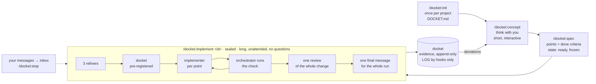

<p>
  <picture>
    <source media="(prefers-color-scheme: dark)" srcset="assets/logo-dark.svg">
    
  </picture>
</p>


Spec in, docket out. A Claude Code plugin that separates thinking from building and makes the building verifiable.

A **delivery docket** is the slip that travels with a shipment and proves what was delivered. Here, every spec
gets one docket: a pre-registered list of what counts as done, filled with evidence, append-only, written by the
team and read by you.

## What it is for

Long, autonomous implementation runs. You think with the model until the WHAT is agreed, write it down as a
spec, then hand it over: one sealed session runs for hours, spawns its own agents, verifies its own work and
ends with one message. docket exists so that such a run can be trusted without watching it: the rules are
enforced by hooks, not by prompts, and the docket shows what was done, with evidence you can check.

It is not a chat assistant for quick edits. The modes before the run are short; the run itself is long.

## Install

Requires Python 3 on PATH. Hooks use the standard library only.

```bash
claude plugin marketplace add hwein/docket
claude plugin install docket@docket
```

Then, in a project: `/docket:init`.

Update (restart Claude Code afterwards):

```bash
claude plugin marketplace update docket
claude plugin update docket@docket
```

Claude Code keeps its own copy of each installed version, so a session never runs a half-updated plugin. Every
push to this repository runs the hook tests on Linux and Windows (`.github/workflows/test.yml`); the badge on the
latest commit shows whether they passed.

## The ideal workflow

1. **Once per project:** `/docket:init`. The repo is audited, you answer only what it cannot answer,
   `DOCKET.md` holds the result. From here every session carries the project's rules.
2. **Think:** `/docket:concept`. One idea at a time, one question at most. Finished dockets are weighed here;
   what differs from a spec is decided here, not patched later.
3. **Decide:** `/docket:spec`. The agreed WHAT becomes a spec: points with done criteria a script can check,
   your decisions closed with one word each, reference docs named. Then it is `ready` and frozen.
4. **Leave:** `/docket:implement <id>`. What only you can provide, a key or a running server, is checked first;
   then the session seals. Refinement, pre-registered docket, one implementer per point, checks run by the
   orchestrator, one review of the whole change, commits per the project's rules. Your messages wait in the
   inbox; `/docket:stop` ends the run cleanly. Nothing asks you anything until the run is over.
5. **Read:** one message for the whole run, in your language: each spec by its title and what it delivered,
   whether the work is pushed and CI is green, what was checked, what is open, what only you can do, and the
   decision that is due. The dockets hold the evidence. What deviated goes back to step 2.

Several specs can wait as `ready`; several sessions can run on different specs at once, each locked to its own.



## Commands

Typed with the plugin's namespace, as Claude Code lists them: `/docket:concept`, `/docket:init`.

| Command | Mode | What happens |
|---|---|---|
| `/docket:init` | init | Audits the repo, asks you only where it is silent, writes `DOCKET.md` after your `go`. |
| `/docket:concept` | concept | Thinks with you. One idea per message, one question at most. |
| `/docket:spec` | spec | Turns the agreed WHAT into a spec with checkable done criteria, then `ready`. |
| `/docket:implement [...]` | sealed | Runs one spec or a series of specs autonomously and ends with one final message (forms below). |
| `/docket:register` | | The register: concepts, specs, dockets, last LOG lines. |
| `/docket:status` | | One line: mode, spec, open points, last LOG line. |
| `/docket:stop` | | Ends a sealed run at the next checkpoint. |

## One spec or a series

A concept ends in one spec or several, in an order (`follows:` in the spec's header). `/docket:implement` runs
them the same way, one after another in one session, each with its own refinement, docket and merge; the run ends
with one message for all of them:

| Call | Runs |
|---|---|
| `/docket:implement` | the next ready spec whose predecessors are done |
| `/docket:implement s-1a2b3c4d` | this spec |
| `/docket:implement s-1a2b3c4d, s-5e6f7a8b` | exactly these, in this order |
| `/docket:implement c-9c8d7e6f` | every ready spec of this concept, in implementation order |
| `/docket:implement --all` | every ready spec of the project, in implementation order |

Implementation order: a spec after every spec it follows, otherwise by creation date. A call that would run a spec
before an undone predecessor is refused and names the predecessor. When a spec is delivered, the hook seals the
next one in the same session. A spec that ends blocked or in dissent ends the series, and the closing message names
the specs not started and the command that resumes them. `/docket:stop` ends the series at the next checkpoint.

## How a sealed run works

1. Three refiner agents read the spec against the code, the concept and the project rules.
2. A docket skeleton is pre-registered: one line per point with the evidence that will count.
3. One implementer agent per point. The orchestrator reads every diff and runs the project check itself.
4. Every delivered point gets its evidence line; what differs from the spec becomes a deviation line.
5. One reviewer agent reads the whole change before it is pushed; every finding is decided in the docket.
6. The spec ends in its docket: delivered, blocked or in dissent, with its result in one sentence and what is
   left open.
7. The run ends with one message, which the hook writes from the dockets and git, in the language `DOCKET.md`
   sets.

While it runs you see a status line, and only when something changed: which spec of how many, its title, the
points delivered. Your own messages go to an inbox the orchestrator reads between points; the closing message
says what came of them.

## What you can rely on

- A spec that is `ready` does not change under you; a rewrite is a logged event.
- A delivered spec means: the project's own check ran green after the last agent, every cited location exists,
  every reference doc the spec names is updated or accounted for.
- Nothing is pushed before one review of the whole change is decided, finding by finding.
- The message at the end is written by the hook from the dockets and git, not from the model's memory.
- The log is written by hooks, not by the model.

## When docket interrupts you

- Before a run: a precondition only you can meet, a key or a running server, is named, and nothing starts.
- A permission dialog: a command from `forbidden_commands`, or a write outside the current mode's files. One click
  runs it once; a sealed run has nobody to ask and refuses.
- A blocker: one line that names what only you can do. Nothing happens until you answer.

## What you see

- During a run: a status line when something changed (which spec, points delivered). At the end: one message
  for the whole run, in your language.
- Never: hashes, ids, hedges, intermediate states, the judge's verdicts.

How the hooks do this: [HOOKS.md](HOOKS.md).

## Where things live

- Plugin: this repository, installed as Claude Code's own copy. In your project `/docket:init` writes only the
  judge hook into `.claude/settings.json`, and only if you opt in; it follows the plugin at every session start.
- Project: `.claude/docket/` for session state (gitignored).
- Work dir with `DOCKET.md`, `specs/`, `dockets/`, `LOG.md`: `~/.docket/<repo key>/` by default, with its own
  git history. `/docket:init` offers `docket/` inside the repo instead.

## Layout

```
commands/   concept, spec, implement, init, register, status, stop
agents/     conceptor, refiner, implementer, reviewer, fixer
hooks/      hooks.json, Python hooks, tests
templates/  DOCKET.md, concept.md, spec.md, delivery-docket.md, judge-hook.json
HOOKS.md    how the hooks enforce the rules
```

Tests: `python hooks/test_hooks.py`.

## Status

0.3.0, an early stage of development, already in use in several repositories.

docket tries not to weigh on existing projects: by default the work dir lives outside the repo, and
`/docket:init` shows every change it would make to the repo as a diff and writes only after your go. Much of
it is yours to set: branch, commit form, forbidden paths and commands, whether the work dir sits in the repo,
whether the judge hook runs.

No warranty. AI makes mistakes, a run that checks itself included. Use docket only where you can verify that
the result is correct.

docket is deliberately not built to save tokens, nor to spend them. It is built for autonomy and for less
cognitive load on your side.
