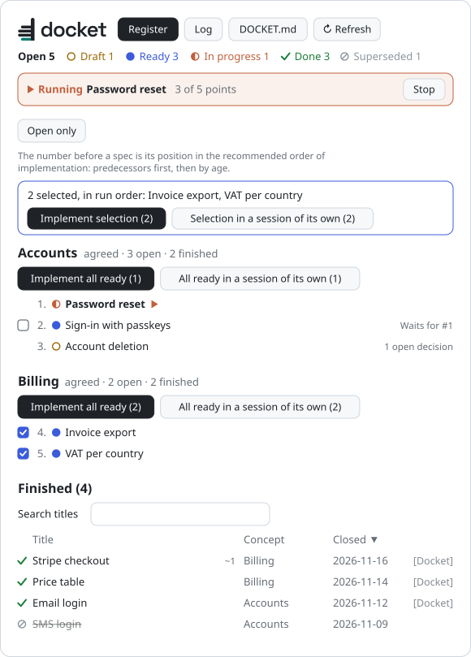

<p>
  <picture>
    <source media="(prefers-color-scheme: dark)" srcset="assets/logo-dark.svg">
    
  </picture>
</p>


Spec in, docket out. A Claude Code plugin that separates thinking from building and makes the building verifiable.

A **delivery docket** is the slip that travels with a shipment and proves what was delivered. Here, every spec
gets one docket: a list of what counts as done, registered before the first code, filled with evidence, written by
the team and read by you.

<p align="center">
  <picture>
    <source media="(prefers-color-scheme: dark)" srcset="assets/pane-dark.svg">
    
  </picture>
  <br>
  <sub>The docket pane beside the chat: the run at work, the open specs by concept, a predecessor before what waits
  for it, two ready specs ticked to run as one series, the finished specs in a table to sort and search. One click
  starts a run, here or in a session of its own. Example data.</sub>
</p>

<p align="center">
  <a href="https://github.com/hwein/docket/actions/workflows/test.yml"></a>
  
  <a href="LICENSE"></a>
</p>

- **Agreed before built.** The spec and its done criteria are fixed before the first line of code.
- **Checked, not claimed.** Every point is closed by a command the orchestrator ran itself, with its output.
- **One message at the end.** The run asks nothing until it is over; deviations and open decisions come with a
  recommendation.

## Install

Requires Python 3 on PATH. Hooks use the standard library only.

```bash
claude plugin marketplace add hwein/docket
claude plugin install docket@docket
```

Then, in a project: `/docket:init`.

Update (restart Claude Code afterwards):

```bash
claude plugin marketplace update docket
claude plugin update docket@docket
```

Optional: the output style `docket:docket` (result first, at most one question), chosen in `/config`.

## Commands

`init` once per project, then `concept → spec → implement → docket`.

| Command | What happens |
|---|---|
| `/docket:init` | Sets the project up and writes `DOCKET.md` after your `go`. |
| `/docket:concept` | Thinks with you until the WHAT is agreed. |
| `/docket:spec` | Turns it into a spec with checkable done criteria, then `ready`. |
| `/docket:implement` | Runs the next ready spec, a spec id, a list of ids, a concept id or `--all`, in order. |
| `/docket:precheck` | Runs the preconditions of ready specs and records whether they are met; a spec that waits for one starts no run. |
| `/docket:register` | Concepts, specs, dockets, last LOG lines. |
| `/docket:status` | One line: mode, spec, open points, last LOG line. |
| `/docket:stop` | Ends a run at the next checkpoint. |

## What you can rely on

- Delivered means: no point open, and the project's check and every acceptance command ran after the last agent
  and passed.
- docket enforces five things: `forbidden_paths`, `push_branch`, `commit_regex`, `forbidden_commands` in a run,
  and the gate before delivered. Details: [HOOKS.md](HOOKS.md).
- At the end of a run docket commits and pushes its own records where they lie in a repository
  (`commit_records: no` turns it off).

The work dir (`DOCKET.md`, `specs/`, `dockets/`, `LOG.md`) is `~/.docket/<repo key>/` by default; `/docket:init`
offers `docket/` in the repo or another folder. docket adds no code to your repository.

## Status

0.6.12, early development. No warranty: use docket only where you can verify the result.
