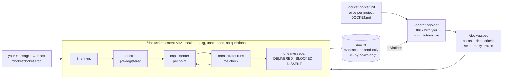

<picture>
  <source media="(prefers-color-scheme: dark)" srcset="assets/logo-dark.svg">
  
</picture>

Spec in, docket out. A Claude Code plugin that separates thinking from building and makes the building verifiable.

A **delivery docket** is the slip that travels with a shipment and proves what was delivered. Here, every spec
gets one docket: a pre-registered list of what counts as done, filled with evidence, append-only, written by the
team and read by you.

## What it is for

Long, autonomous implementation runs. You think with the model until the WHAT is agreed, write it down as a
spec, then hand it over: one sealed session runs for hours, spawns its own agents, verifies its own work and
ends with one message. docket exists so that such a run can be trusted without watching it: the rules are
enforced by hooks, not by prompts, and the docket shows what was done, with evidence you can check.

It is not a chat assistant for quick edits. The modes before the run are short; the run itself is long.

## The ideal workflow

1. **Once per project:** `/docket:docket init`. The repo is audited, you answer only what it cannot answer,
   `DOCKET.md` holds the result. From here every session carries the project's rules.
2. **Think:** `/docket:concept`. One idea at a time, one question at most. Finished dockets are weighed here;
   what differs from a spec is decided here, not patched later.
3. **Decide:** `/docket:spec`. The agreed WHAT becomes a spec: points with done criteria a script can check,
   your decisions closed with one word each, reference docs named. Then it is `ready` and frozen.
4. **Leave:** `/docket:implement <id>`. The session seals. Refinement, pre-registered docket, one implementer
   per point, checks run by the orchestrator, commits per the project's rules. Your messages wait in the inbox;
   `/docket:docket stop` ends the run cleanly. Nothing asks you anything until the docket is written.
5. **Read:** one message, `DOCKET DELIVERED`, `DOCKET BLOCKED` or `DOCKET DISSENT`, in plain words. The docket
   has the evidence. What deviated goes back to step 2.

Several specs can wait as `ready`; several sessions can run on different specs at once, each locked to its own.



## Commands

Typed with the plugin's namespace, as Claude Code lists them: `/docket:concept`, `/docket:docket init`.

| Command | Mode | What happens |
|---|---|---|
| `/docket:docket init` | init | Audits the repo, asks you only where it is silent, writes `DOCKET.md` after your `go`. |
| `/docket:concept` | concept | Thinks with you. One idea per message, one question at most. |
| `/docket:spec` | spec | Turns the agreed WHAT into a spec with checkable done criteria, then `ready`. |
| `/docket:implement <id>` | sealed | Runs the spec autonomously and ends with exactly one message. |
| `/docket:docket` | | The register: concepts, specs, dockets, last LOG lines. |
| `/docket:docket status` | | One line: mode, spec, open points, last LOG line. |
| `/docket:docket stop` | | Ends a sealed run at the next checkpoint. |

## How a sealed run works

1. Three refiner agents read the spec against the code, the concept and the project rules.
2. A docket skeleton is pre-registered: one line per point with the evidence that will count.
3. One implementer agent per point. The orchestrator reads every diff and runs the project check itself.
4. Every delivered point gets its evidence line; what differs from the spec becomes a deviation line.
5. The run ends with `DOCKET DELIVERED`, `DOCKET BLOCKED` or `DOCKET DISSENT`. The session is then closed.

While it runs, your messages go to an inbox the orchestrator reads between points.

## What the hooks enforce

Hooks check provenance, form and state, never content.

- Specs freeze at `ready`; the docket is append-only; `LOG.md` is written by hooks only.
- `DOCKET DELIVERED` passes only if the check ran after the last agent returned, every cited `file:line`
  exists, and every reference doc the spec names is updated or accounted for.
- Project rules from `DOCKET.md` (branch, commit form, forbidden paths and commands) apply to every command.
- Every message in every session of the project ends with a time stamp fetched from the clock. No hashes, ids
  or hedges reach you.

## Install

Requires Python 3 on PATH. Hooks use the standard library only.

```bash
claude plugin marketplace add /path/to/docket
claude plugin install docket@docket-local
```

Then, in a project: `/docket:docket init`.

## Where things live

- Plugin: this repository. Nothing is copied into your project.
- Project: `.claude/docket/` for session state (gitignored).
- Work dir with `DOCKET.md`, `specs/`, `dockets/`, `LOG.md`: `~/.docket/<repo key>/` by default, with its own
  git history. `/docket init` offers `docket/` inside the repo instead.

## Layout

```
commands/   concept, spec, implement, docket
agents/     conceptor, refiner, implementer, fixer
hooks/      hooks.json, Python hooks, tests
templates/  DOCKET.md, concept.md, spec.md, delivery-docket.md, check.py, judge-hook.json
```

Tests: `python hooks/test_hooks.py`.

## Status

0.1.3. Every command has run end to end in a toy project; not yet used on a real codebase.
