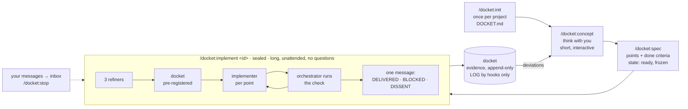

<p>
  <picture>
    <source media="(prefers-color-scheme: dark)" srcset="assets/logo-dark.svg">
    
  </picture>
</p>


Spec in, docket out. A Claude Code plugin that separates thinking from building and makes the building verifiable.

A **delivery docket** is the slip that travels with a shipment and proves what was delivered. Here, every spec
gets one docket: a pre-registered list of what counts as done, filled with evidence, append-only, written by the
team and read by you.

## What it is for

Long, autonomous implementation runs. You think with the model until the WHAT is agreed, write it down as a
spec, then hand it over: one sealed session runs for hours, spawns its own agents, verifies its own work and
ends with one message. docket exists so that such a run can be trusted without watching it: the rules are
enforced by hooks, not by prompts, and the docket shows what was done, with evidence you can check.

It is not a chat assistant for quick edits. The modes before the run are short; the run itself is long.

## The ideal workflow

1. **Once per project:** `/docket:init`. The repo is audited, you answer only what it cannot answer,
   `DOCKET.md` holds the result. From here every session carries the project's rules.
2. **Think:** `/docket:concept`. One idea at a time, one question at most. Finished dockets are weighed here;
   what differs from a spec is decided here, not patched later.
3. **Decide:** `/docket:spec`. The agreed WHAT becomes a spec: points with done criteria a script can check,
   your decisions closed with one word each, reference docs named. Then it is `ready` and frozen.
4. **Leave:** `/docket:implement <id>`. The session seals. Refinement, pre-registered docket, one implementer
   per point, checks run by the orchestrator, commits per the project's rules. Your messages wait in the inbox;
   `/docket:stop` ends the run cleanly. Nothing asks you anything until the docket is written.
5. **Read:** one message, `DOCKET DELIVERED`, `DOCKET BLOCKED` or `DOCKET DISSENT`, in plain words. The docket
   has the evidence. What deviated goes back to step 2.

Several specs can wait as `ready`; several sessions can run on different specs at once, each locked to its own.



## Commands

Typed with the plugin's namespace, as Claude Code lists them: `/docket:concept`, `/docket:init`.

| Command | Mode | What happens |
|---|---|---|
| `/docket:init` | init | Audits the repo, asks you only where it is silent, writes `DOCKET.md` after your `go`. |
| `/docket:concept` | concept | Thinks with you. One idea per message, one question at most. |
| `/docket:spec` | spec | Turns the agreed WHAT into a spec with checkable done criteria, then `ready`. |
| `/docket:implement <id>` | sealed | Runs the spec autonomously and ends with exactly one message. |
| `/docket:register` | | The register: concepts, specs, dockets, last LOG lines. |
| `/docket:status` | | One line: mode, spec, open points, last LOG line. |
| `/docket:stop` | | Ends a sealed run at the next checkpoint. |

## How a sealed run works

1. Three refiner agents read the spec against the code, the concept and the project rules.
2. A docket skeleton is pre-registered: one line per point with the evidence that will count.
3. One implementer agent per point. The orchestrator reads every diff and runs the project check itself.
4. Every delivered point gets its evidence line; what differs from the spec becomes a deviation line.
5. The run ends with `DOCKET DELIVERED`, `DOCKET BLOCKED` or `DOCKET DISSENT`. The session is then closed.

While it runs, your messages go to an inbox the orchestrator reads between points.

## What the hooks enforce

Hooks check provenance, form and state, never content.

- Specs freeze at `ready`; the docket is append-only; `LOG.md` is written by hooks only.
- `DOCKET DELIVERED` passes only if every command of the project's check (as many as the project has, listed in
  `DOCKET.md`) ran after the last agent returned and none failed, every cited `file:line` exists, and every
  reference doc the spec names is updated or accounted for.
- Project rules from `DOCKET.md` (branch, commit form, forbidden paths) apply to every command. A forbidden
  command is not refused but put to you as a permission dialog: one click runs it once, and the LOG records the
  grant. A sealed run has nobody to ask, so there it stays refused.
- Every message in every session of the project ends with a time stamp; the hooks hand the time to the model with
  every prompt and tool result, so no tool call is spent on it. No hashes, ids or hedges reach you, and a blocker
  is said once: the same `Blocker` line twice in a row is refused. A blocker also ends the turn: until you answer,
  nothing is written and no agent or workflow starts.
- Each mode keeps to its work: concept mode writes concepts and `DOCKET.md`, any other write in the repo comes to you
  as a permission dialog, and an order for specs given there is answered with `/docket:spec`. The question in the
  desktop app's next-step box counts toward the one question, and a sealed run asks none there either. A quoted
  hook answer must have come from a hook in this session.
- The optional judge (a prompt hook, per project) checks the form of a message after you read it: one question
  at most, no option menus, no manual tasks for you beyond the one step of a blocker, no promises, no self-talk.
  Whether a sentence names its source is a rule of the prose, not of the judge. Its verdicts go to Claude and the
  log, never to your screen: Claude answers them with silence.
- docket adds no code to your repository. The judge entry `/docket:init` writes into `.claude/settings.json`
  follows the plugin: every session start brings it to the installed version, so an update needs no second init; a
  judge you changed stays as it is.

## Install

Requires Python 3 on PATH. Hooks use the standard library only.

```bash
claude plugin marketplace add hwein/docket
claude plugin install docket@docket
```

Then, in a project: `/docket:init`.

Update (restart Claude Code afterwards):

```bash
claude plugin marketplace update docket
claude plugin update docket@docket
```

Claude Code keeps its own copy of each installed version, so a session never runs a half-updated plugin. Every
push to this repository runs the hook tests on Linux and Windows (`.github/workflows/test.yml`); the badge on the
latest commit shows whether they passed.

## Where things live

- Plugin: this repository, installed as Claude Code's own copy. In your project `/docket:init` writes only the
  judge hook into `.claude/settings.json`, and only if you opt in; it follows the plugin at every session start.
- Project: `.claude/docket/` for session state (gitignored).
- Work dir with `DOCKET.md`, `specs/`, `dockets/`, `LOG.md`: `~/.docket/<repo key>/` by default, with its own
  git history. `/docket:init` offers `docket/` inside the repo instead.

## Layout

```
commands/   concept, spec, implement, init, register, status, stop
agents/     conceptor, refiner, implementer, fixer
hooks/      hooks.json, Python hooks, tests
templates/  DOCKET.md, concept.md, spec.md, delivery-docket.md, judge-hook.json
```

Tests: `python hooks/test_hooks.py`.

## Status

0.2.8, an early stage of development, already in use in several repositories.

docket tries not to weigh on existing projects: by default the work dir lives outside the repo, and
`/docket:init` shows every change it would make to the repo as a diff and writes only after your go. Much of
it is yours to set: branch, commit form, forbidden paths and commands, whether the work dir sits in the repo,
whether the judge hook runs.

No warranty. AI makes mistakes, a run that checks itself included. Use docket only where you can verify that
the result is correct.

docket is deliberately not built to save tokens, nor to spend them. It is built for autonomy and for less
cognitive load on your side.
